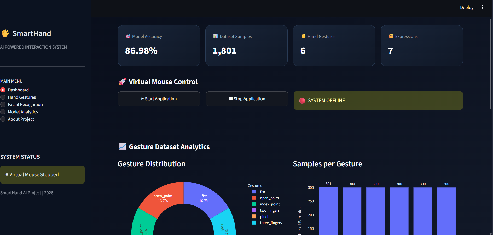

 <div align="center">

# 🖐️ SmartHand

### AI-Powered Virtual Mouse Using Hand Gestures & Facial Expression Recognition

**Control your computer with simple hand gestures — no physical mouse required!**

<p>
  
  
  
  
</p>

<p>
  <b>🤖 Artificial Intelligence | 👁️ Computer Vision | ✋ Gesture Recognition</b>
</p>

</div>

---

## 🌟 About SmartHand

**SmartHand** is an AI-powered Human-Computer Interaction project that transforms your webcam into a virtual mouse.

It uses **hand gesture recognition** to control mouse operations such as cursor movement, left-click, right-click, scrolling, and pause functionality.

Additionally, SmartHand integrates **facial expression recognition** to identify visible facial-expression categories in real time.

The project combines Machine Learning, Computer Vision, and automation to create a touch-free computer interaction experience.

## ✨ Key Features

| Feature | Description |
|---|---|
| ✋ Hand Detection | Detects hand landmarks using MediaPipe |
| 🖱️ Virtual Mouse | Controls the cursor using hand gestures |
| 👆 Left Click | Pinch gesture performs left-click |
| 👉 Right Click | Three-finger gesture performs right-click |
| 🤚 Scroll Control | Two-finger gesture controls scrolling |
| ✊ Pause Control | Fist gesture pauses mouse interaction |
| 😊 Facial Expression Recognition | Recognizes seven visible expression categories |
| 📊 ML Dashboard | Streamlit dashboard with model visualizations |
| 📈 Model Evaluation | Confusion matrix and classification metrics |

## 🖐️ Supported Hand Gestures

| Gesture | Action |
|---|---|
| 🖐️ Open Palm | Activate virtual mouse |
| ✊ Fist | Pause virtual mouse |
| ☝️ Index Point | Move cursor |
| ✌️ Two Fingers | Scroll |
| 🤏 Pinch | Left Click |
| 🤟 Three Fingers | Right Click |

## 📸 Project Screenshots

### 1. SmartHand Dashboard


### 2. Confusion Matrix


### 3. Virtual Mouse in Action


### 4. Facial Expression Recognition


## 🧠 Machine Learning Model

SmartHand uses a **Random Forest Classifier** for hand gesture classification.

**Gesture Recognition Details:**
- 21 hand landmarks detected using MediaPipe.
- 63 normalized landmark features (X, Y, Z).
- Six gesture classes.
- 300 decision trees in the Random Forest model.
- Stratified 80:20 train-test split.

<div align="center">

### 🎯 Gesture Model Accuracy

# 86.98%

<sub>Measured on a random stratified held-out test set of 361 samples.</sub>

</div>

**Facial Expression Recognition:**

- YuNet for face detection.
- MobileFaceNet-based ONNX model for expression recognition.
- Seven categories: Angry, Disgust, Fearful, Happy, Neutral, Sad, and Surprised.

*Note: Facial expression labels represent visible expression categories, not a definitive measurement of a person's internal emotional state.*

## 🛠️ Tech Stack

| Technology | Purpose |
|---|---|
| Python | Core programming |
| OpenCV | Image processing and webcam access |
| MediaPipe | Hand landmark detection |
| NumPy | Numerical operations |
| Pandas | Dataset handling |
| Scikit-learn | Random Forest classification |
| PyAutoGUI | Mouse automation |
| ONNX | Facial expression model |
| Streamlit | Interactive dashboard |
| Plotly | Data visualization |
| Matplotlib | Confusion matrix visualization |

## 📂 Project Structure

```text
SmartHand/
│
├── dataset/
│   └── gestures.csv
│
├── docs/
│   └── architecture.md
│
├── models/
│   ├── gesture_model.pkl
│   ├── hand_landmarker.task
│   ├── face_detection_yunet_2023mar.onnx
│   ├── facial_expression_recognition_mobilefacenet_2022july.onnx
│   └── confusion_matrix.png
│
├── screenshots/
│   ├── dashboard.png
│   ├── confusion matrix.png
│   ├── SmartHand - Virtual Mouse.png
│   └── SmartHand -  Facial Recognition.png
│
├── app.py
├── collect_data.py
├── train_model.py
├── realtime_recognition.py
├── virtual_mouse.py
├── facial_fer_model.py
├── face_expression_test.py
├── requirements.txt
└── README.md
```

## ⚙️ Installation & Setup

### Step 1: Clone the Repository

```bash
git clone https://github.com/HarshuPatil1216/SmartHand.git
```

### Step 2: Navigate to Project

```bash
cd SmartHand
```

### Step 3: Create Virtual Environment

```bash
python -m venv venv
```

### Step 4: Activate Virtual Environment

**Windows PowerShell:**

```powershell
.\venv\Scripts\Activate.ps1
```

### Step 5: Install Dependencies

```bash
python -m pip install -r requirements.txt
```

### Step 6: Run SmartHand Virtual Mouse

```bash
python virtual_mouse.py
```

### Step 7: Run Streamlit Dashboard

```bash
streamlit run app.py
```

## 🎮 How to Use

1. Connect your webcam.
2. Run the SmartHand application.
3. Show your hand in front of the camera.
4. Use the supported gestures to control your mouse.
5. View facial-expression categories on the camera display.
6. Open the Streamlit dashboard to explore model visualizations.

## 🚀 Future Improvements

- Improve gesture recognition accuracy with more diverse training sessions.
- Add customizable hand gesture mappings.
- Improve cursor stability and responsiveness.
- Add voice command integration.
- Support multiple languages.
- Enhance accessibility features.

## 👨‍💻 Developer

<div align="center">

### Harshavardhan Patil

**Third Year | Artificial Intelligence & Machine Learning**

KIT's College of Engineering, Kolhapur

[](https://github.com/HarshuPatil1216)

[](https://github.com/HarshuPatil1216/SmartHand)

</div>

---

<div align="center">

### ⭐ If you like this project, don't forget to star the repository!

**Built with ❤️ using Python, Machine Learning & Computer Vision.**

</div>